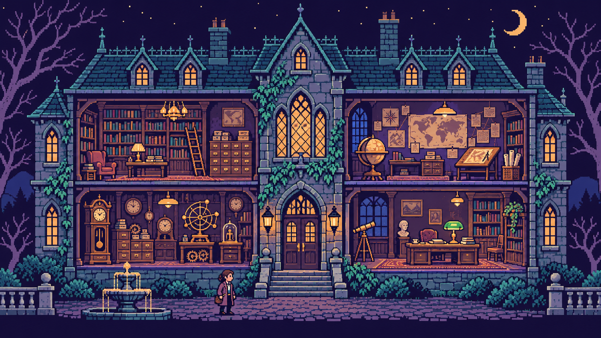

> **Portfolio maintenance status · 12 November 2026:** historical/reference scope; no further independent product expansion is planned. [Current TACITUS research workspace](https://app.tacitus.me/). [Purpose, retained work, retirement gates and restoration](TACITUS_RETIREMENT.md). Repository archival is a separate checked operation; this notice alone does not claim it occurred.

# CONCORDIA — voice-AI mediation prototype

<!-- tacitus-practical-entry -->
## Purpose, code and a playable introduction

Explore a voice-assisted dialogue workspace that makes discussion context available for subsequent structured review.

**Research prototype.** Hackathon/research prototype. Voice processing, realtime transport, consent and deployment configuration are separate from passing local unit tests; no mediation-outcome claim is made.

[Setup, code walkthrough, research & verification](TACITUS_GUIDE.md) · [Play the original 8-bit teaching adventure](tacitus-demo/index.html) · [Demo credits](tacitus-demo/CREDITS.md)



Research: [RAG](https://arxiv.org/abs/2005.11401), [long-context evidence use](https://arxiv.org/abs/2307.03172), [GraphRAG](https://arxiv.org/abs/2404.16130). [What TACITUS borrows, adds and still needs to measure](https://github.com/sargonxg/sargonxg/blob/main/docs/RESEARCH_AND_DESIGN.md).
<!-- /tacitus-practical-entry -->


[](package.json)
[](next.config.mjs)


> **Status: completed hackathon prototype.** CONCORDIA is preserved as a portfolio case study and is not an active service, maintained product, or substitute for professional mediation or legal advice.

CONCORDIA explored how real-time voice AI could support a structured mediation workflow without reducing conflict to a generic chat transcript. The prototype combined live audio, multi-party room orchestration, document-assisted intake, a typed conflict ontology, an evolving graph interface, and a draft-agreement workflow.

Built in 2026 by **Giulio Catanzariti** as part of the TACITUS research program.

## What the prototype explored

- **Voice-mediated sessions:** a custom Node.js and WebSocket server connected browser participants to Gemini Live Audio.
- **Structured intake:** party information, initial statements, documents, priorities, constraints, and ground rules were assembled before the live session.
- **Typed conflict representation:** utterances could be mapped to actors, claims, interests, constraints, leverage, commitments, events, and narratives.
- **Live analytical interface:** the workspace visualized extracted objects, relationships, emotional trajectories, and possible areas of common ground.
- **Resolution workflow:** the prototype supported option generation, range-based negotiation experiments, session summaries, and a draft settlement document.

The repository contains the experimental interface, APIs, room manager, mediation-method library, tests, Docker configuration, and deployment scaffold. See [ARCHITECTURE.md](ARCHITECTURE.md) for the original technical design.

## Architecture at a glance

```text
Browser participants
        │
        ├── WebSocket audio and session events
        │
Custom Node.js server / room manager
        │
        ├── Gemini Live Audio
        ├── structured extraction and analysis routes
        └── session state and agreement workflow
        │
Next.js workspace
        ├── intake
        ├── live mediation room
        ├── conflict graph
        └── review and export
```

## Run locally

Prerequisites: Node.js 20+ and a Gemini API key with the required model access.

```bash
git clone https://github.com/sargonxg/H2_CONCORDIA_GHACK_SUBMISSION.git
cd H2_CONCORDIA_GHACK_SUBMISSION
npm install
cp .env.example .env
# Add the required Gemini credential to .env.
npm run dev
```

The code is retained in its prototype state. Dependencies, model identifiers, and external APIs may have changed since the project was completed; local operation is therefore not guaranteed without maintenance.

## Boundaries

CONCORDIA has not been validated as a mediation service, clinical system, legal product, or autonomous decision-maker. Affect, intent, power, escalation, and agreement quality are difficult human judgments. Prototype outputs should be treated as hypotheses for review, not determinations about people or disputes. Do not upload confidential or sensitive case material without first reviewing the code, data flow, provider terms, access controls, and retention behavior.

## Relationship to current TACITUS work

The experiment informed later work on source provenance, reviewable analytical objects, portable context, and human-gated workflows. Current development is centered on [PRAXIS](https://praxis.tacitus.me), [DIALECTICA](https://github.com/sargonxg/A3_DIALECTICAbyTACITUS_v3), [AGON](https://github.com/sargonxg/AGON), and [KAIROS](https://github.com/sargonxg/KAIROS-temporal-vision-TACITUS).

## Reuse

No open-source license is currently declared for this repository. The public code is provided for inspection as a completed prototype; public availability should not be interpreted as permission to redistribute or commercialize it. Third-party dependencies remain subject to their own licenses.
